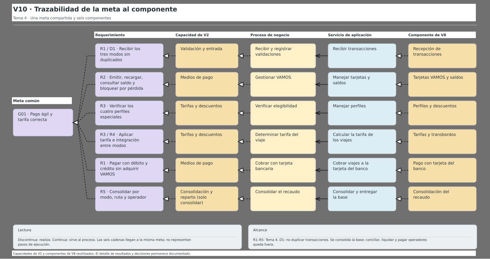
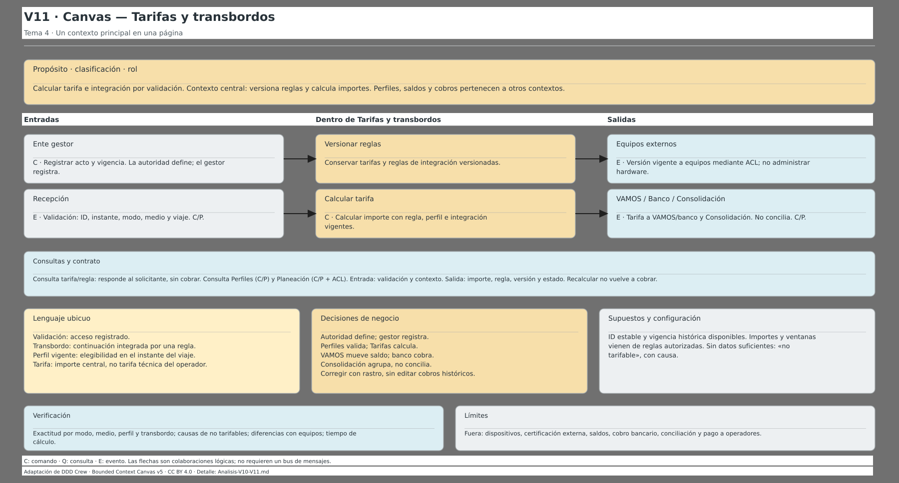

# Recaudo integrado — Tema 4 · rama CHANDA

Proyecto de **Arquitectura de Software**: aplicación de recaudo para buses alimentadores, buses articulados y metro.

## Referencia canónica de esta rama

**El archivo vigente es [`modelo/recaudo_tema4.archimate`](modelo/recaudo_tema4.archimate).** Abrirlo con Archi 5.x. Contiene cuatro vistas dentro de **Views**:

| Vista | Contenido vigente |
|---|---|
| **V2** | Mapa de capacidades del negocio. Su contenido se conserva como referencia canónica. |
| **V8** | Seis contextos, sus servicios/interfaces e intercambios con sistemas externos. |
| **V10** | Una meta compartida y seis cadenas de trazabilidad hasta los componentes. |
| **V11** | Canvas de Tarifas y transbordos: propósito/clasificación/rol, comunicaciones, lenguaje, decisiones, supuestos y verificación. |

Esta es la base canónica de **CHANDA**, no una declaración de que el proyecto completo o las once vistas estén terminados. Las demás vistas se integrarán con los avances del equipo. Las exportaciones antiguas de `vistas/` se retiran porque pertenecían a versiones descartadas; siguen recuperables en el historial de Git.

El modelo conserva conceptos heredados que no aparecen en estas cuatro vistas. Su presencia en el árbol **no convierte las decisiones de las versiones descartadas en decisiones aprobadas**.

## Alcance y límites

La aplicación recibe transacciones de los tres modos, gestiona VAMOS y sus saldos, verifica perfiles, aplica reglas tarifarias e integración, procesa el cobro con tarjeta bancaria y consolida por modo, ruta y operador.

**Fuera de alcance:** administrar validadores/lectores, conciliación financiera, liquidación y pago a operadores. La aplicación entrega una base consolidada, no una base ya conciliada.

Se mantienen seis contextos, no uno por cada modo, medio o perfil:

1. Recepción de transacciones.
2. Perfiles y descuentos.
3. Tarifas y transbordos.
4. Tarjetas VAMOS y saldos.
5. Pago con tarjeta del banco.
6. Consolidación del recaudo.

No se prescriben microservicios, colas o infraestructura adicional por usar DDD. Importes, porcentajes y ventanas de transbordo provienen de reglas autorizadas; no se inventan valores.

## Presentación

V8, V10 y V11 usan el fondo normal de Archi, rótulos blancos y una paleta coherente con V2. No hay un panel blanco de tamaño completo sobre el lienzo.

Las siguientes imágenes son **bocetos de composición**, no capturas ni exportaciones exactas del renderizado de Archi. El modelo editable prevalece.

### V10 — trazabilidad

[](Bocetos/V10-boceto-03.pdf)

### V11 — canvas

[](Bocetos/V11-boceto-04.pdf)

## Archivos de apoyo

- [`Bocetos/README.md`](Bocetos/README.md): versiones de referencia y archivos fuente SVG/PDF/PNG.
- [`Bocetos/Decisiones-V8.md`](Bocetos/Decisiones-V8.md): límites y relaciones del mapa de contextos.
- [`Bocetos/Analisis-V10-V11.md`](Bocetos/Analisis-V10-V11.md): cobertura del enunciado, relaciones y decisiones actuales.

Los bocetos superados, copias `.bak`, bloqueos de LibreOffice, archivos QA y previsualizaciones técnicas del MCP **no forman parte de esta entrega**. El documento local del enunciado se mantiene privado y excluido de Git.

## Regeneración y comprobación

Requiere Python 3.12+; para los PDF/PNG, `rsvg-convert` de librsvg. Estos comandos escriben artefactos locales; antes de regenerar, guardar cualquier edición manual del modelo en una copia.

```bash
python Bocetos/compactar_v10_v11.py
python Bocetos/implementar_v10_v11.py
python Bocetos/verificar_v10_v11.py
```

- `compactar_v10_v11.py` genera las escenas y SVG vigentes.
- `implementar_v10_v11.py` regenera únicamente V10 y V11 y verifica que las otras vistas no cambien. Conserva una copia de recuperación local.
- `verificar_v10_v11.py` comprueba contenido, geometría, referencias y preservación de V2; para V8 permite solo el retiro autorizado del fondo blanco respecto de la copia anterior.
- `actualizar_v8.py` es un generador separado: **no ejecutarlo para actualizar V10/V11**.

En el entorno Cortex, ejecutar estas comprobaciones mediante `cortex-sandbox`.

### Alcance de la validación realizada

- El modelo completo carga en el MCP ArchiMate y sus referencias visuales son válidas.
- La validación semántica aislada de V10/V11 pasó con **34 conceptos, 33 relaciones únicas y cero incidencias**. Son 34 conexiones visuales: una relación compartida se dibuja más de una vez.
- La validación semántica global sigue bloqueada por un elemento heredado sin nombre. No se declara resuelto ni se confunde con la comprobación de las vistas nuevas.
- El renderizador del MCP no reproduce exactamente fuentes, figuras y expresiones de rótulo de la aplicación. La revisión final de presentación se realiza abriendo el modelo en Archi.

## Abrir los cambios en Archi

Si el archivo se modifica mientras está abierto, cerrar **el modelo completo**, no solo la pestaña de una vista, y abrirlo nuevamente. No guardar una sesión antigua sobre el archivo actualizado. Si hay cambios propios sin guardar, conservarlos primero en una copia distinta.

**Esta rama no modifica `main` ni sustituye los aportes de los compañeros.**
