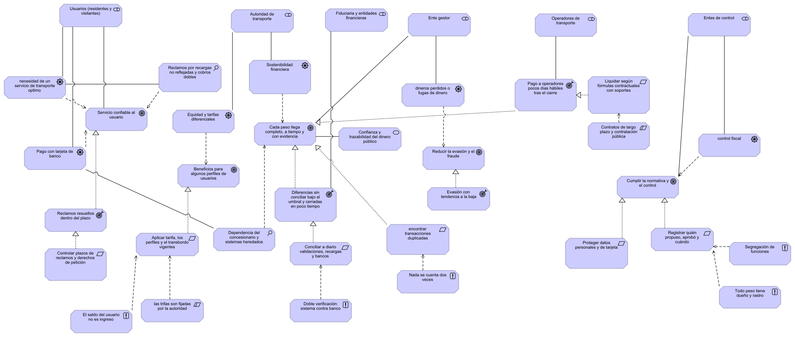
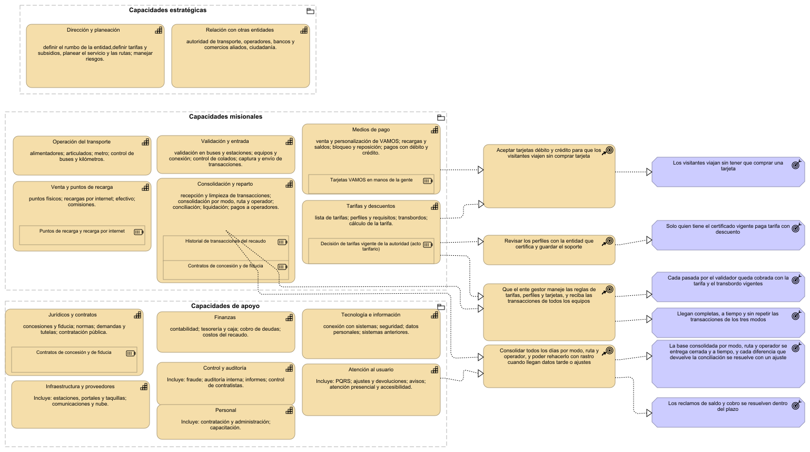
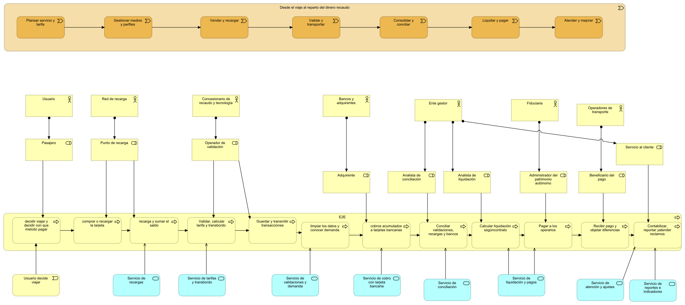
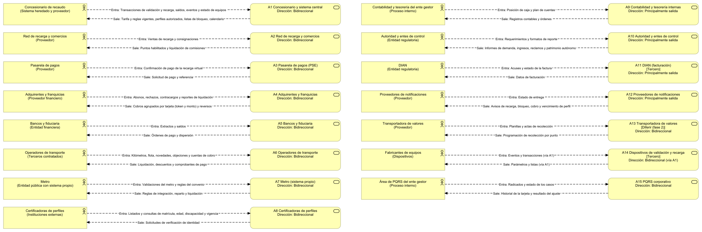
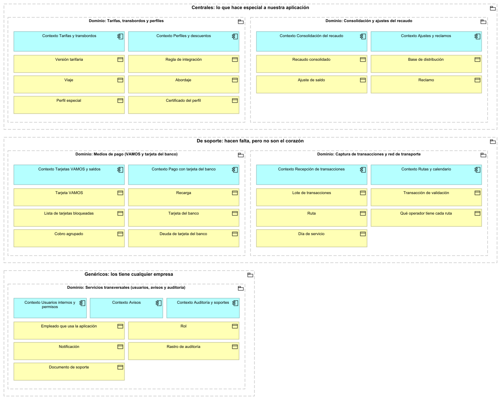
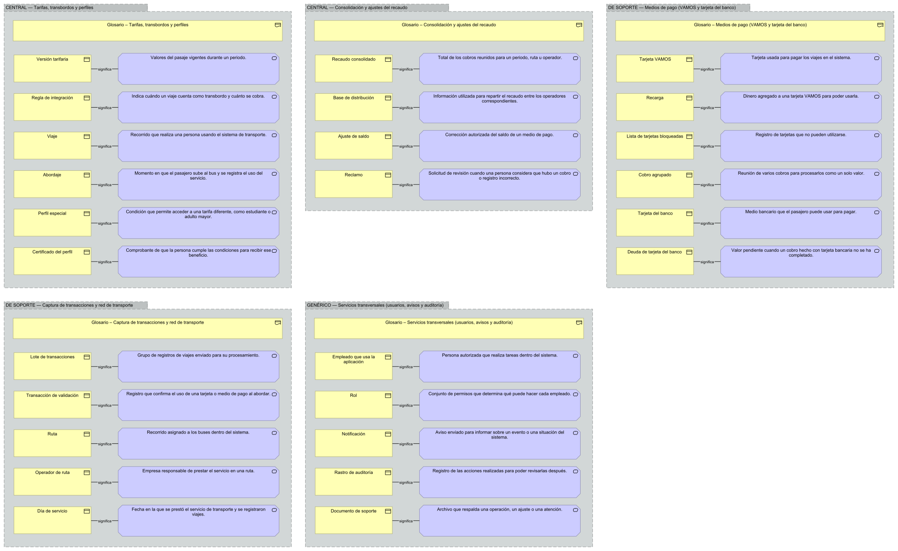
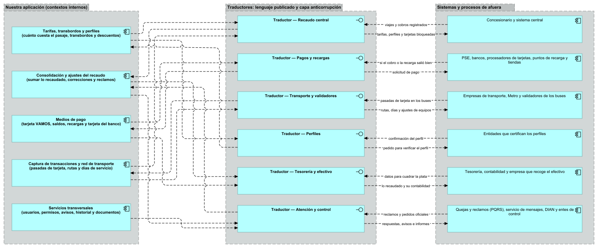
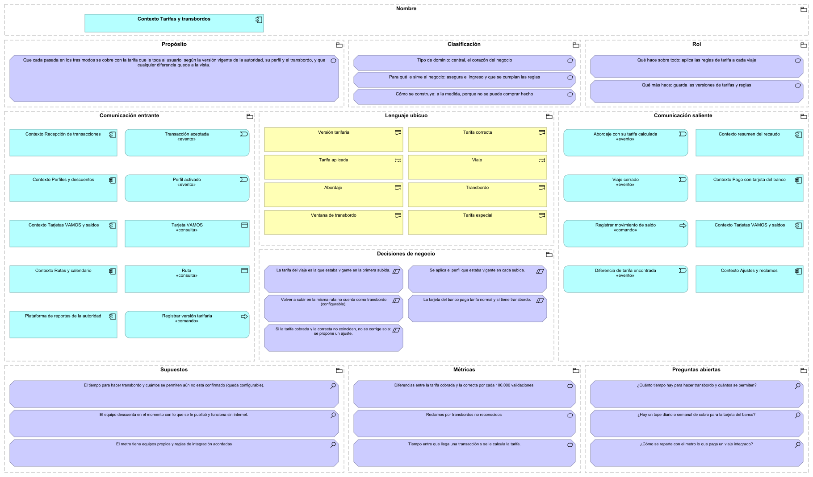

# Recaudo del sistema integrado de transporte de una ciudad mediana

**Proyecto:** «Diseño de la arquitectura de una aplicación empresarial con ArchiMate y DDD», Tema 4. Arquitectura de Software, UPB.

**Integrantes:** Simón Bedoya, Santiago Hernández y Sebastián Quijano.

> **Modelo ArchiMate:** [`modelo/BUSES.archimate`](modelo/BUSES.archimate). Es un único modelo que se abre con Archi 5.x y trae las vistas de la V1 a la V11 en la carpeta *Views*. La V4.1 es la capa anticorrupción de la V4. Las imágenes de las vistas están en [`vistas/`](vistas/); al hacer clic en una imagen se abre en grande.

## Índice

1. [Contexto y entrevista (Fase 0)](#1-contexto-y-entrevista-fase-0)
2. [Motivación (Fase 1)](#2-motivación-fase-1) · [V1](#v1-motivación)
3. [Mapa de capacidades y proceso E2E (Fase 1)](#3-mapa-de-capacidades-y-proceso-e2e-fase-1) · [V2](#v2-mapa-de-capacidades) · [V3](#v3-cadena-de-valor-y-proceso-e2e)
4. [Descomposición de servicios (Fase 2)](#4-descomposición-de-servicios-fase-2) · [V4](#v4-descomposición-de-servicios) · [V4.1](#v41-capa-anticorrupción) · [Inclusión y exclusión](#tabla-de-inclusión-y-exclusión) · [Contratos](#contratos-contract-first)
5. [Dominios y lenguaje ubicuo (Fase 3)](#5-dominios-y-lenguaje-ubicuo-fase-3) · [V5](#v5-dominios) · [V7](#v7-lenguaje-ubicuo)
6. [Agregados, comandos y eventos (Fase 4)](#6-agregados-comandos-y-eventos-fase-4) · [V6](#v6-agregados-comandos-y-eventos)
7. [Mapa de contextos e interoperabilidad (Fase 5)](#7-mapa-de-contextos-e-interoperabilidad-fase-5) · [V8](#v8-mapa-de-contextos) · [V9](#v9-interoperabilidad-y-anticorrupción)
8. [Bounded Context Canvas (Fase 6)](#8-bounded-context-canvas-fase-6) · [V11](#v11-bounded-context-canvas)
9. [Trazabilidad vertical](#9-trazabilidad-vertical) · [V10](#v10-trazabilidad-vertical)
10. [Decisiones y supuestos](#10-decisiones-y-supuestos)
11. [Tabla de aportes](#11-tabla-de-aportes)

**Contenido del repositorio**

| Carpeta | Qué hay |
|---|---|
| [`entrevista/`](entrevista/) | [`entrevista.pdf`](entrevista/entrevista.pdf): la instrucción de rol, la tabla de hallazgos del equipo con su decisión y justificación, y la conversación completa con el experto |
| [`modelo/`](modelo/) | El modelo ArchiMate fuente: [`BUSES.archimate`](modelo/BUSES.archimate) |
| [`vistas/`](vistas/) | Las vistas exportadas desde Archi: V1.svg a V11.svg y V4.1.svg |

**Cómo se citan las fuentes.** «T4» es el texto del Tema 4 del enunciado. «B3» es el bloque 3 de preguntas de la entrevista (ver el guion en la sección 1) y «B3.1» es la sección 1 de la respuesta del experto a ese bloque. «7_SOA diap. 35», «6_TOGAF diap. 41» y «9_DDD diap. 11» son diapositivas de las clases.

---

## 1. Contexto y entrevista (Fase 0)

**El problema (Tema 4).** «Operamos el sistema integrado de transporte de la ciudad, con tres modos…» y se necesita un software que apoye el recaudo y permita a residentes y visitantes pagar su viaje de forma ágil y con la tarifa que les corresponde. El alcance incluye:
- tres modos: buses alimentadores, buses articulados y metro;
- dos formas de pago: la tarjeta propia de la ciudad (VAMOS) y las tarjetas débito y crédito, para que los visitantes puedan viajar sin comprar una tarjeta;
- el manejo de la tarjeta VAMOS: emisión, recargas, consulta de saldo y bloqueo por pérdida;
- la tarifa plena y las tarifas especiales para estudiantes de colegio, universitarios, adultos mayores y personas con movilidad reducida, revisando que cada usuario cumpla las condiciones de su perfil;
- la tarifa correcta en cada validación, teniendo en cuenta los transbordos entre modos;
- la consolidación del recaudo por modo, ruta y operador, como base para repartir el dinero y conciliarlo.

**La entrevista.** El equipo configuró una IA como experto de negocio con más de 15 años en la gerencia de recaudo y operación de un sistema integrado de transporte masivo en una ciudad mediana. La [entrevista completa](entrevista/entrevista.pdf) tiene la instrucción de rol, la tabla de hallazgos del equipo y la conversación.

**Instrucción de rol.** Además del perfil del experto, el contexto le aclara que un equipo de estudiantes de arquitectura de software lo entrevistará para entender el negocio y que ellos diseñarán el software, no él. Sus reglas:
1. Responder en primera persona, con ejemplos concretos y cifras de orden de magnitud solo cuando sean razonables; si no está seguro, decirlo.
2. No proponer mapas de capacidades, dominios, agregados, contextos delimitados, diagramas ArchiMate ni arquitectura de software: eso lo decide el equipo.
3. Distinguir entre norma o hecho verificable, práctica común del sector y supuesto propio, marcando cada afirmación con [Norma], [Práctica] o [Supuesto].
4. Citar las normas con nombre y número para que el equipo las verifique, y decir si no las recuerda con certeza.
5. No inventar datos de una ciudad o empresa real.
6. Pedir aclaración si la pregunta es ambigua.
7. Cerrar cada bloque con un resumen de máximo 8 viñetas y su nivel de certeza (alto, medio o bajo).
8. Responder en español, de forma concisa.

También se le pidió usar las normas de Colombia.

**Guion.** Diez bloques, uno por cada tema que pide el enunciado. Hay preguntas abiertas («Cuéntame el proceso completo…»), de profundización («De esas fuerzas, ¿cuáles son las más urgentes y por qué?») y de validación («¿Es correcto entender que el operador del sistema recauda y luego reparte…? Corrígeme»; «¿Hay algún actor que olvidé?»). El bloque B9 es el bloque específico de interoperabilidad.

| Bloque | Tema | Preguntas | Ejemplo |
|---|---|---|---|
| B1 | Contexto y motivación | 6 | ¿Quiénes son las partes interesadas de un sistema integrado de transporte y qué espera cada una del recaudo? |
| B2 | Organización | 8 | recuerda Responde en primera persona |
| B3 | Proceso de punta a punta | 7 | Cuéntame el proceso completo desde que alguien decide viajar hasta que el dinero queda registrado y repartido. |
| B4 | Actores | 6 | ¿Qué personas y organizaciones participan en el recaudo y qué hace cada una? |
| B5 | Reglas de negocio | 8 | ¿Cómo se definen las tarifas y cada cuánto cambian? |
| B6 | Excepciones | 7 | ¿Qué casos raros o problemáticos ocurren con más frecuencia? |
| B7 | Indicadores | 5 | ¿Qué indicadores usa la gerencia para saber si el recaudo va bien? |
| B8 | Sistemas | 6 | ¿Qué sistemas de información intervienen en el recaudo hoy? |
| B9 | Interoperabilidad | 14 | ¿Con qué otros procesos internos, áreas, sistemas y entidades externas intercambia información el recaudo? |
| B10 | Normatividad | 5 | ¿Qué leyes, decretos y reglamentos gobiernan el transporte público y su recaudo? |

Las preguntas completas están en la [entrevista](entrevista/entrevista.pdf).

**Análisis de hallazgos.** Tabla del equipo con la decisión sobre cada hallazgo y su justificación (está también en la [entrevista](entrevista/entrevista.pdf)):

| # | Hallazgo | Decisión | Justificación |
|---|---|---|---|
| 1 | Fraude con tarjeta | Se tiene en cuenta | Una tarjeta puede ser rechazada o generar un contracargo después de que la persona ya viajó. |
| 2 | Venta de tarjetas | Se tiene en cuenta | Es parte del dominio de apoyo. |
| 3 | Tasa estimada de evasión | Se tiene en cuenta | Permite conocer en un panel cuánto dinero se evadió. |
| 4 | La tarifa la fija la autoridad competente | Se tiene en cuenta | La tarifa no la ponen ni los operadores ni los analistas de recaudo. |
| 5 | La remuneración a operadores (por kilómetro, por pasajero o mixta) y los plazos de pago están pactados | Se tiene en cuenta, pero no se implementa todo | Aunque los pagos están pactados, no se tomarán los kilómetros. |
| 6 | Cierres diarios con cortes contables claros | Se tiene en cuenta | Permite ver el análisis diario de la demanda. |
| 7 | Uso de la tarjeta VAMOS para acceder a tarifas diferenciales; con tarjeta de banco se paga tarifa completa | Se tiene en cuenta | Decisión de negocio: solo se accede a estas tarifas con las tarjetas personalizadas. |
| 8 | Reclamos: recargas pagadas que no aparecen en el saldo, cobros dobles o transbordos no reconocidos, validadores fuera de servicio o que pierden transacciones, y tarjetas perdidas o dañadas con saldo | Se tiene en cuenta | Son algunos de los reclamos que se tendrán en cuenta, aunque luego saldrán otros. |
| 9 | Si hay un viaje previo dentro de la ventana, aplica la tarifa integrada | Se tiene en cuenta | Es la mejor forma de hacer los transbordos. |
| 10 | Los estudiantes tienen una tarifa diferencial verificable con certificado de la institución | Se tiene en cuenta, pero no se implementa del todo | En este grupo puede haber fraude recurrente por préstamo de tarjeta. |
| 11 | En una misma ruta no se reconoce transbordo: si el usuario baja y vuelve a subir en la misma ruta o línea, se cobra como un viaje nuevo | Se tiene en cuenta | Evita que una persona haga un viaje de ida y vuelta con un mismo pago. |
| 12 | Por canal: el efectivo suele tener topes y controles por punto; el canal virtual permite montos mayores y exige verificar al titular | Se tiene en cuenta | — |
| 13 | Si la tarjeta es personalizada se puede reclamar el saldo ante pérdida; si es anónima, suele no recuperarse | Se tiene en cuenta | Otra de las reglas del negocio que se tuvieron en cuenta. |

**Cómo influyeron en el diseño.** Estos son los hallazgos de la entrevista que más pesaron, con la referencia al bloque donde los dijo el experto:

| Hallazgo | Decisión | Dónde se ve |
|---|---|---|
| La tarifa la fija la autoridad; el área de recaudo no la decide (B1.5, B4.4) | Aceptado | Restricción de la V1; el ente gestor registra la versión tarifaria (V6, V11) |
| Reglas de oro con el dinero de los pasajeros: todo peso tiene dueño y rastro, nada se cuenta dos veces, doble verificación, segregación de funciones, el saldo del usuario no es ingreso (B1.6) | Aceptado | Principios de la V1 y reglas de los agregados (V6) |
| Reclamos frecuentes: recargas que no aparecen, cobros dobles, validadores que pierden transacciones y tarjetas perdidas con saldo (B2.6, B6.1) | Aceptado | Evaluación de la V1; ajustes y reclamos (V5, V6, V8) |
| Solo las tarjetas VAMOS personalizadas acceden a tarifas especiales; con tarjeta del banco se paga tarifa plena (B2.5) | Aceptado | Perfiles y descuentos (V6, V7, V11) |
| El cobro con tarjeta del banco se agrupa al cierre del día o al pasar un límite (B3.3) | Aceptado como supuesto | Agregado «Viajes por cobrar a una tarjeta del banco» (V6) |
| Una misma ruta no cuenta como transbordo (B5.4) | Aceptado, como regla ajustable | Reglas de la versión tarifaria y del viaje (V6, V11) |
| Las transacciones llegan tarde o repetidas; cada una tiene un número único y su día de servicio (B6.4) | Aceptado | Agregado «Transacción de validación» (V6) |
| Ley 1581 de 2012 (datos personales) y Ley 1755 de 2015 (derecho de petición) (B1.5, B10) | Contrastado con el texto de la ley | Requerimiento de proteger los datos (V1); plazos de reclamos |
| Umbrales numéricos de los indicadores (B7.3) | Descartado: el propio experto dijo que no son un estándar | Los resultados no llevan cifras meta |

---

## 2. Motivación (Fase 1)

### V1. Motivación

**Qué muestra.** Por qué existe la aplicación, con los elementos de motivación que salieron del bloque 1 de la entrevista:
- **Interesados (6):** usuarios (residentes y visitantes), autoridad de transporte, fiduciaria y entidades financieras, ente gestor, operadores de transporte y entes de control (B1.1).
- **Impulsores (6):** la necesidad de un servicio de transporte óptimo, la sostenibilidad financiera, la equidad y las tarifas diferenciales, el pago con tarjeta del banco, el dinero que se pierde o se fuga y el control fiscal (B1.2, B1.3).
- **Evaluaciones (2):** los reclamos por recargas no reflejadas y cobros dobles, y la dependencia del concesionario y de sistemas heredados (B2.6, B8.1).
- **Metas (5):** servicio confiable al usuario; que cada peso llegue completo, a tiempo y con evidencia (lo que busca la gerencia, B1.4); reducir la evasión y el fraude; cumplir la normativa y el control; y beneficios para algunos perfiles de usuarios. **Valor:** confianza y trazabilidad del dinero público.
- **Resultados (4):** pago a los operadores pocos días hábiles después del cierre, diferencias sin conciliar bajo el umbral y cerradas en poco tiempo, evasión con tendencia a la baja y reclamos resueltos dentro del plazo. Salen de los indicadores que dio el experto (B1.4, B7.2).
- **Requerimientos (7):** controlar los plazos de reclamos y derechos de petición; aplicar la tarifa, los perfiles y el transbordo vigentes; conciliar a diario validaciones, recargas y bancos; encontrar transacciones duplicadas; liquidar según las fórmulas de los contratos, con soportes; proteger los datos personales y de tarjeta; y registrar quién propuso, quién aprobó y cuándo.
- **Restricciones (2):** las tarifas las fija la autoridad, y los contratos son de largo plazo y de contratación pública (B1.5).
- **Principios (5):** el saldo del usuario no es ingreso; doble verificación del sistema contra el banco; nada se cuenta dos veces; segregación de funciones; y todo peso tiene dueño y rastro (B1.6).

**Cómo se lee.** Cada interesado se asocia con lo que le preocupa (impulsor o meta). Los impulsores y las evaluaciones influyen en las metas; los resultados y los requerimientos las hacen realidad (realización); y los principios y las restricciones influyen en los requerimientos. Por ejemplo: el ente gestor → «cada peso llega completo, a tiempo y con evidencia» ← «diferencias sin conciliar bajo el umbral» ← «conciliar a diario validaciones, recargas y bancos» ← principio «doble verificación: sistema contra banco».

**Por qué así.** Se sigue el esquema de motivación de la clase (6_TOGAF diap. 41): interesado → impulsor → evaluación → meta → resultado → requerimiento, con principios y restricciones que guían los requerimientos. Todos los elementos se le preguntaron al experto en la entrevista, como pide el enunciado. Las metas y los requerimientos son del negocio de recaudo completo; la aplicación los apoya con sus servicios (V3, V4) y la V10 muestra cómo cada parte de la aplicación llega a una meta.

---

## 3. Mapa de capacidades y proceso E2E (Fase 1)

### V2. Mapa de capacidades

**Qué muestra.** Todo lo que el negocio de recaudo sabe hacer, en tres franjas, como en la clase (7_SOA diap. 35):
**Capacidades estratégicas:** dirección y planeación (rumbo de la entidad, tarifas y subsidios, planeación del servicio y de las rutas, riesgos) y relación con otras entidades (autoridad, operadores, bancos, comercios aliados y ciudadanía). **Capacidades misionales:** operación del transporte, validación y entrada, medios de pago, venta y puntos de recarga, consolidación y reparto, y tarifas y descuentos. **Capacidades de apoyo:** jurídicos y contratos, finanzas, tecnología e información, infraestructura y proveedores, control y auditoría, atención al usuario y personal.

Cada capacidad dice adentro lo que incluye. Los **recursos** van dentro de la capacidad que los usa: las tarjetas VAMOS en manos de la gente (medios de pago), los puntos de recarga y la recarga por internet (venta y puntos de recarga), el historial de transacciones del recaudo (consolidación y reparto), los contratos de concesión y de fiducia (consolidación y reparto, y jurídicos y contratos) y la decisión de tarifas vigente de la autoridad (tarifas y descuentos).

A la derecha están las **capacidades impactadas** por la aplicación y lo que se hará con ellas: las capacidades que la aplicación toca (medios de pago, tarifas y descuentos, consolidación y reparto y atención al usuario) hacen posibles cuatro **cursos de acción**, y cada curso de acción lleva a los **resultados** que se esperan:
aceptar tarjetas débito y crédito → los visitantes viajan sin tener que comprar una tarjeta; revisar los perfiles con la entidad que los certifica y guardar el soporte → solo quien tiene el certificado vigente paga tarifa con descuento; que el ente gestor maneje las reglas de tarifas, perfiles y tarjetas y reciba las transacciones de todos los equipos → cada pasada queda cobrada con la tarifa y el transbordo vigentes, y las transacciones de los tres modos llegan completas, a tiempo y sin repetirse; consolidar todos los días por modo, ruta y operador, y poder rehacerlo con rastro → la base consolidada se entrega cerrada y a tiempo, y los reclamos de saldo y cobro se resuelven dentro del plazo.

**Por qué así.** El mapa es del negocio completo y no solo de la aplicación; por eso aparecen capacidades que la aplicación no toca, como la operación del transporte, el personal o la infraestructura. Las capacidades no se unen entre sí porque no son pasos de un proceso. Las líneas de realización muestran el camino capacidad → curso de acción → resultado, que es lo que pide la vista (capacidad, recurso y curso de acción).

### V3. Cadena de valor y proceso E2E

**Qué muestra.** Dónde se ubica la aplicación en el negocio:
- **Arriba, la cadena de valor** «Desde el viaje al reparto del dinero recaudado», con siete etapas: planear el servicio y la tarifa, gestionar medios y perfiles, vender y recargar, validar y transportar, consolidar y conciliar, liquidar y pagar, y atender y mejorar.
- **En el medio, los actores y sus roles:** el usuario es pasajero; la red de recarga es punto de recarga; el concesionario de recaudo y tecnología es operador de validación; los bancos y adquirentes son adquirentes; el ente gestor tiene los roles de analista de conciliación, analista de liquidación y servicio al cliente; la fiduciaria administra el patrimonio autónomo, y los operadores de transporte son los beneficiarios del pago.
- **Abajo, el proceso E2E** con doce pasos, desde que el usuario decide viajar (evento que lo inicia) hasta contabilizar, reportar y atender reclamos: decidir viajar y el medio de pago, comprar o recargar la tarjeta, recargar y sumar el saldo, validar y calcular la tarifa y el transbordo, guardar y transmitir las transacciones, limpiar los datos y conocer la demanda, hacer los cobros acumulados a las tarjetas del banco, conciliar validaciones, recargas y bancos, calcular la liquidación según el contrato, pagar a los operadores, recibir el pago y objetar diferencias, y contabilizar, reportar y atender reclamos.
- **Debajo de los pasos, los servicios de la aplicación** que los apoyan: recargas; tarifas y transbordo; validaciones y demanda; cobro con tarjeta bancaria; conciliación; liquidación y pagos; atención y ajustes; y reportes e indicadores.

**Por qué así.** La cadena de valor y el proceso salen del recorrido que contó el experto (B3.1) y de los actores que nombró (B2.1, B4.1). Poner los servicios de la aplicación debajo del paso que apoyan, con la relación «sirve a» (6_TOGAF diap. 44), muestra en una sola vista dónde actúa la aplicación dentro del proceso.

---

## 4. Descomposición de servicios (Fase 2)

Desde el proceso E2E se bajó por seis capas de servicio (7_SOA diap. 20 y 28) hasta servicios de tamaño adecuado. Son 78 servicios: 61 se implementan, 7 se reutilizan, 6 los presta un tercero y 4 se difieren a una segunda fase. La letra del código dice la capa: P plataforma, D dominio, S subdominio, A anticorrupción, F fundamental (datos maestros) e I infraestructura.

### V4. Descomposición de servicios

**Qué muestra.**
- **Arriba, el proceso E2E de recaudo** en seis etapas: gestionar medios y perfiles; vender, recargar y cobrar; validar y acceder; consolidar y conciliar; liquidar y pagar; y atender, reportar y controlar.
- **Debajo, una franja por capa**, de arriba abajo: **Servicios de negocio de plataforma (P1-P6):** uno por etapa del proceso. **Servicios de dominio (D1-D13):** las funciones del negocio de cada etapa, como gestión de tarjetas y titulares, tarifas y transbordo, consolidación de demanda o liquidación a operadores. **Servicios básicos de subdominio (S1-S29):** las tareas concretas de cada dominio, como emitir y personalizar la tarjeta, calcular el cobro agrupado o detectar el uso indebido de beneficios. **Capa anticorrupción (A1-A15):** un servicio por cada sistema o entidad de afuera (detalle en la V4.1). **Servicios fundamentales (F1-F8):** los datos maestros que usan todos: tarjetas y titulares, perfiles, tarifas y reglas, operadores y rutas, equipos y puntos, contratos, calendario y terceros. **Infraestructura (I1-I7):** identidad y permisos, auditoría, notificaciones, gestión documental, protección de datos, mensajería y monitoreo.
- **A la derecha de cada franja, el equipo que responde por ella** (asignación).
- **Lo que entra y lo que no:** cada servicio que no se implementa lleva su decisión como etiqueta: «[Reutilizar]», «[Tercero]» o «[Diferir (fase 2)]». Los que no tienen etiqueta se implementan.

**Por qué así.** Son seis capas, más de las cuatro que pide el enunciado, porque así separa la clase lo que es del negocio (plataforma y dominio), las tareas reutilizables (subdominio), lo que viene de afuera (anticorrupción), los datos que comparten todos (fundamentales) y lo técnico (infraestructura). Separar la capa anticorrupción evita que los formatos de los sistemas de afuera se metan en el diseño. Cada servicio es un servicio de negocio con su rol, sus actores y su contrato, como pide el *Contract First* (7_SOA diap. 44-47).

### V4.1. Capa anticorrupción

**Qué muestra.** Los 15 servicios anticorrupción, cada uno frente a su sistema o entidad de afuera, que puede ser un proveedor, un proceso interno, una entidad regulatoria, una entidad financiera o un dispositivo. Entre los dos hay dos flujos: **«Entra»** (lo que llega a la aplicación) y **«Sale»** (lo que la aplicación envía). Cada servicio dice su dirección: bidireccional o principalmente de salida.

**Por qué así.** Va en una vista aparte porque dentro de la V4 los textos de los intercambios no se podían leer. Cada intercambio es un flujo con nombre, uno por dirección (6_TOGAF diap. 35), y sale del bloque de interoperabilidad de la entrevista (B9.3 a B9.12).

### Tabla de inclusión y exclusión

Qué servicios se implementan y cuáles no, con la justificación de cada decisión. **Implementar:** lo hace la aplicación. **Reutilizar:** ya existe en la organización y se usa. **Tercero:** lo presta otra empresa o sistema y la aplicación solo consume el resultado. **Diferir:** queda para una segunda fase.

Se implementan 61: los 6 de plataforma (P1-P6), los 13 de dominio (D1-D13), 21 de los 29 de subdominio, 12 de los 15 anticorrupción, 6 de los 8 fundamentales y 3 de los 7 de infraestructura (I2 auditoría, I5 protección de datos e I6 mensajería). Son el núcleo del recaudo que pide el Tema 4: tarjetas, perfiles, tarifas, transacciones, cobros y consolidación. Estos son los 17 que **no** se implementan:

| Código | Servicio | Capa | Decisión | Justificación |
|---|---|---|---|---|
| S1 | Emitir y personalizar tarjeta | Subdominio básico | Tercero | La personalización física y la programación del medio las hace el concesionario; la aplicación solo consume el resultado por A1 y mantiene el maestro (F1). |
| S7 | Gestionar puntos y comisiones | Subdominio básico | Diferir | Hoy las comisiones se manejan en hojas de cálculo con bajo riesgo; se prioriza la conciliación. Fase 2. |
| S8 | Cuadrar efectivo por punto | Subdominio básico | Diferir | Depende de la transportadora de valores y del banco; se hace después de conciliar contra bancos. Fase 2. |
| S12 | Calcular tarifa y transbordo | Subdominio básico | Tercero | Se ejecuta en validadores y sistema central en milisegundos y sin conexión; la aplicación define las reglas (S11) y audita el resultado. |
| S15 | Monitorear equipos | Subdominio básico | Tercero | El concesionario ya opera la gestión de equipos; la aplicación consume indicadores por A1. |
| S23 | Consolidar posición de caja | Subdominio básico | Reutilizar | Tesorería ya cuenta con su herramienta; la aplicación aporta los datos por A9. |
| S24 | Radicar y seguir reclamos | Subdominio básico | Reutilizar | La radicación formal y los plazos legales ya existen en el PQRS corporativo; se integra por A15. |
| S29 | Gestionar casos y sanciones | Subdominio básico | Diferir | Primero se detecta; la sanción depende del reglamento y de la autoridad. Fase 2. |
| A11 | DIAN (facturación) | Anticorrupción | Tercero | La facturación electrónica se emite desde el sistema financiero existente; la aplicación entrega datos por A9. |
| A13 | Transportadora de valores | Anticorrupción | Diferir | Solo aplica con el cuadre de efectivo (S8). Fase 2. |
| A14 | Dispositivos de validación y recarga | Anticorrupción | Tercero | Los equipos son propietarios; se accede solo por el concesionario (A1) para no acoplarse a protocolos del fabricante. |
| F5 | Maestro de equipos y puntos de recarga | Fundamental | Tercero | El catálogo vive en el concesionario; se consulta por A1. |
| F8 | Maestro de terceros | Fundamental | Reutilizar | El ERP corporativo ya administra bancos, comercios y certificadoras. |
| I1 | Identidad y permisos | Infraestructura | Reutilizar | Se usa el inicio de sesión único y los roles corporativos. |
| I3 | Notificaciones al usuario | Infraestructura | Reutilizar | Se usa la plataforma de mensajería existente con el proveedor A12. |
| I4 | Gestión documental y evidencias | Infraestructura | Reutilizar | Se usa el gestor documental institucional. |
| I7 | Observabilidad y monitoreo | Infraestructura | Reutilizar | Se usa la herramienta corporativa de monitoreo. |

### Contratos (Contract First)

Cada servicio tiene su contrato en el modelo: un objeto de negocio *contrato* asociado al servicio, con sus operaciones y los objetos que entran y salen (por ejemplo, el de S1 «Emitir y personalizar tarjeta» tiene las operaciones solicitarEmisión y confirmarEmisión, y recibe y devuelve tarjeta y titular). Los de plataforma y dominio son compuestos: reúnen los contratos de los servicios que les sirven. No se dibujan en la V4 para no taparla.

---

## 5. Dominios y lenguaje ubicuo (Fase 3)

Desde aquí el diseño va en la capa de aplicaciones. **Cómo se encontraron los dominios** (9_DDD diap. 8-10):
1. Se miró cómo está organizada la entidad y quién responde por qué (B2.1, B4.2).
2. Se siguió el proceso paso a paso con lo que pasa en cada uno (los eventos de la V6).
3. Se buscaron los puntos donde cambia el dueño de la información. Por ejemplo, la transacción la recibe Recepción de transacciones, le calcula la tarifa Tarifas y transbordos y la asigna a su ruta y operador el resumen del recaudo.

### V5. Dominios

**Qué muestra.** Cinco dominios agrupados por su clasificación. Cada dominio tiene arriba las partes de la aplicación que lo atienden (contextos, como componentes de aplicación) y abajo su información principal (objetos de negocio):

| Clasificación | Dominio | Contextos | Información principal |
|---|---|---|---|
| **Central** | Tarifas, transbordos y perfiles | Tarifas y transbordos; Perfiles y descuentos | Versión tarifaria, regla de integración, viaje, abordaje, perfil especial y certificado del perfil |
| **Central** | Consolidación y ajustes del recaudo | Resumen del recaudo; Ajustes y reclamos | Recaudo consolidado, base de distribución, ajuste de saldo y reclamo |
| **De soporte** | Medios de pago (VAMOS y tarjeta del banco) | Tarjetas VAMOS y saldos; Pago con tarjeta del banco | Tarjeta VAMOS, recarga, lista de tarjetas bloqueadas, tarjeta del banco, cobro agrupado y deuda de tarjeta del banco |
| **De soporte** | Captura de transacciones y red de transporte | Recepción de transacciones; Rutas y calendario | Lote de transacciones, transacción de validación, ruta, qué operador tiene cada ruta y día de servicio |
| **Genérico** | Servicios transversales (usuarios, avisos y auditoría) | Usuarios internos y permisos; Avisos; Auditoría y soportes | Empleado que usa la aplicación, rol, notificación, rastro de auditoría y documento de soporte |

**Por qué esta clasificación** (9_DDD diap. 11):
- **Centrales, lo que hace única a la aplicación.** *Tarifas, transbordos y perfiles* es lo que el Tema 4 pide como diferencia: tiene las reglas que más cambian y sus errores causan la mayoría de los reclamos (B3.6, B6.1, B6.3). Los perfiles van aquí porque solo sirven para decidir qué tarifa le toca a cada quien (B5.2, B5.3). *Consolidación y ajustes del recaudo* sostiene la meta de que cada peso llegue a quien le corresponde y es la base para repartir el dinero; las disputas con los operadores son por cuántos pasajeros se le cuentan a cada uno (B1.1, B3.6). Los ajustes van aquí porque corrigen lo que ya se sumó, siempre con la aprobación de una segunda persona (B4.3, B6.3).
- **De soporte, necesarios pero no son el corazón.** *Medios de pago:* sin medio de pago no hay viaje, pero sus reglas son conocidas en el sector (B3.2, B3.3, B6.2). *Captura de transacciones y red de transporte:* le da al núcleo lo que necesita: las transacciones limpias y las rutas, operadores y días de servicio (B6.4, B9.6).
- **Genérico, igual que en cualquier empresa.** *Servicios transversales:* usuarios y permisos, avisos y auditoría los tiene cualquier organización y se pueden comprar hechos; en el ejemplo de la clase, «Reportes y Auditoría» es genérico (9_DDD diap. 11 y 13).

Un dominio puede tener varios contextos: por eso los once contextos de la V8 se agrupan en cinco dominios.

### V7. Lenguaje ubicuo

**Qué muestra.** Un bloque por dominio, con su clasificación y su nombre arriba. Adentro van el glosario del dominio (una *representación*) y cada palabra del negocio (objeto de negocio) unida a lo que significa (*significado*) con la relación «significa». Son 26 palabras, las de la información principal de cada dominio de la V5, y cada una se llama igual en todo el modelo.

Ejemplos de uso: *día de servicio*: un viaje a las 00:30 puede pertenecer al día anterior; *cobro agrupado*: los viajes del día de una tarjeta del banco se cobran al cierre; *ajuste de saldo*: abono por un cobro doble, aprobado por una segunda persona; *certificado del perfil*: el listado de matrícula que envía una universidad.

**Palabras que significan cosas distintas según quién las use.** Están en el modelo, cada significado asociado al contexto donde vale:

| Palabra | Significados |
|---|---|
| Operador | Para el resumen del recaudo, la empresa de transporte a la que se le asignan los pasajeros de una ruta. El experto a veces llama «operador» al concesionario de recaudo y tecnología, y en general usa la palabra para el ente gestor, el operador de buses, el concesionario o la fiduciaria. |
| Viaje | Para Tarifas y transbordos, los abordajes enlazados que pagan una tarifa integrada. Para el resumen del recaudo, la demanda se cuenta por abordajes: un viaje con transbordo cuenta dos o tres veces. Para planeación, un trayecto de origen a destino estimado. |
| Saldo | Para Tarjetas VAMOS y saldos, el último saldo conocido. En la tarjeta, el saldo escrito en el chip, que es el que se descuenta. Para contabilidad, dinero ajeno que no es ingreso hasta que se usa. |
| Tarifa | Para Tarifas y transbordos, la tarifa correcta según la versión, el perfil y el transbordo. Para Recepción de transacciones, la que descontó el equipo en el momento. Para la autoridad, la tarifa técnica (lo que cuesta cada pasajero) frente a la tarifa al usuario. |
| Recaudado | Para el experto hay cuatro momentos: dinero capturado, recaudado, ingreso por el viaje y distribuible. Para el resumen del recaudo, el valor de las validaciones y los cobros del día de servicio. |
| Cobro | Para Pago con tarjeta del banco, el cargo agrupado después de los viajes. Para Tarjetas VAMOS, el descuento del saldo al validar. |

---

## 6. Agregados, comandos y eventos (Fase 4)

### V6. Agregados, comandos y eventos

**Qué muestra.** Un diagrama por dominio, como pide el enunciado: cinco recuadros en una sola vista, cada uno con los agregados de su dominio. Cada agregado muestra:
- **su raíz** (objeto de datos marcado «raíz»): la puerta de entrada, porque todo cambio pasa por ella; adentro van sus partes: **entidades**, que se reconocen por su identificador, y **objetos de valor**, como un monto, una fecha o un estado;
- **los comandos** (procesos de aplicación): las órdenes que lo cambian, cada una con su línea de acceso a la raíz;
- **los eventos** (eventos de aplicación): lo que ya pasó, disparado por el comando.

Por ejemplo, en *Tarjeta VAMOS*: emitir, personalizar, bloquear y reponer la tarjeta y registrar un movimiento de saldo → tarjeta emitida, personalizada, bloqueada, repuesta con su saldo y saldo actualizado.

**Reglas que nunca se rompen (invariantes) y por qué cada agregado tiene ese tamaño**

| Dominio | Agregado | Reglas que nunca se rompen |
|---|---|---|
| Tarifas, transbordos y perfiles | Perfil especial | Solo tarjetas personalizadas; cada tipo pide su prueba vigente; un perfil activo por tarjeta; al vencer deja de aplicarse sin bloquear; quitarlo lo decide alguien autorizado. |
|  | Versión tarifaria | Se apoya en una decisión de la autoridad; nunca dos versiones vigentes a la vez; una aprobada no se toca, se hace otra; no aplica hacia atrás. |
|  | Viaje | Cada abordaje es de un solo viaje; los abordajes caben en el tiempo de transbordo; se cobra con la regla y el perfil vigentes; la diferencia con lo cobrado queda anotada. |
| Consolidación y ajustes del recaudo | Consolidado del día de servicio | Cada transacción se cuenta una vez; recargas, viajes y cobros del banco nunca se mezclan; un día cerrado solo cambia con una versión nueva; la base sale solo de días cerrados. |
|  | Ajuste | Quien propone no aprueba; los montos altos los aprueba alguien de más arriba; todo ajuste dice a qué se refiere; se aplica una sola vez. |
| Medios de pago | Tarjeta VAMOS | Número único; el saldo solo cambia por movimientos registrados; una tarjeta perdida no se reactiva, se repone; solo la personalizada pasa su saldo a la nueva. |
|  | Recarga | Cada operación se cuenta una vez; monto entre el mínimo y el máximo del canal; no se recarga una tarjeta bloqueada; la recarga por internet espera que el equipo la confirme. |
|  | Lista de bloqueo | Una versión publicada no cambia; cada tarjeta dice por qué está; aparece una sola vez; sacar una bloqueada por fraude necesita el visto bueno de un jefe. |
|  | Viajes por cobrar a una tarjeta del banco | Cada viaje entra en un solo cobro; se cobra al cierre o al pasar el límite; con deuda, el token va a la lista de bloqueo; nunca se guarda el número completo de la tarjeta. |
| Captura de transacciones y red de transporte | Transacción de validación | Número único, así nada se cuenta dos veces; cuenta el día en que pasó; la tardía fuera de plazo queda aparte; aceptada no se cambia, se corrige con un ajuste. |
|  | Ruta | Un solo operador por periodo, sin cruces; los cambios rigen hoy o después, nunca hacia atrás. |
|  | Calendario de días de servicio | Una sola hora de cierre por día; un día publicado solo cambia antes de empezar. |
| Servicios transversales | Notificación | Un solo aviso por cada cosa que pasa. |
|  | Registro de auditoría | Los registros solo se agregan; nunca se cambian ni se borran. |
|  | Usuario interno | La misma persona no puede proponer y aprobar el mismo tipo de ajuste. |

**Por qué así (alcance de los agregados).** Cada agregado es lo más pequeño que permite cumplir sus reglas de una sola vez:
La recarga va aparte de la tarjeta porque nace en canales de afuera y se confirma después. Cada transacción es su propio agregado, para poder recibir cientos de miles al día sin que se estorben (B2.3). El consolidado de cada día de servicio es la unidad del cierre diario. El ajuste va aparte porque necesita su propia aprobación y no puede editar lo que corrige. Los viajes por cobrar a una tarjeta del banco se agrupan por tarjeta, porque el cobro es uno solo por varios viajes (B3.3).

En ArchiMate, cada agregado es una agrupación; la raíz y sus partes son objetos de datos; los comandos son procesos de aplicación que escriben en la raíz y disparan eventos de aplicación (9_DDD diap. 18-23).

---

## 7. Mapa de contextos e interoperabilidad (Fase 5)

### V8. Mapa de contextos

**Qué muestra.** Los once contextos de la aplicación (componentes de aplicación), cada uno con la etiqueta de su tipo de dominio ([central], [de soporte] o [genérico]), una nota «Responde por», su interfaz (API) y sus servicios de aplicación. Son cuatro centrales (Tarifas y transbordos, Perfiles y descuentos, Resumen del recaudo, Ajustes y reclamos), cuatro de soporte (Tarjetas VAMOS y saldos, Pago con tarjeta del banco, Recepción de transacciones, Rutas y calendario) y tres genéricos (Usuarios internos y permisos, Avisos, Auditoría y soportes). Las líneas son flujos con lo que se pasa y, entre corchetes, el patrón de relación.

**Patrones de relación** (de quien entrega a quien usa):
- **[C/P] Cliente-proveedor:** quien usa la información dice qué necesita y quien la entrega se compromete a darla. Por ejemplo: de Recepción a Tarifas, la transacción aceptada en un formato único; de Tarifas al resumen del recaudo, cada subida con su tarifa calculada; de Tarjetas VAMOS al resumen, las recargas del día, aparte del consumo; de Perfiles a Tarifas, el perfil activado, vencido o revocado.
- **[OHS/PL] Servicio abierto con lenguaje publicado:** Rutas y calendario publica un formato fijo que usan Recepción, Tarifas y el resumen del recaudo.
- **[CF] Conformista:** Ajustes y reclamos toma los roles y permisos de los empleados tal como vienen.
- **[OHS] Servicio abierto:** Avisos le presta su servicio de envío a Pago con tarjeta del banco y a Perfiles (relación «servida por»): son ellos los que le piden mandar un aviso cuando les pasa algo.
- **Núcleo compartido:** solo los códigos que todos deben entender igual: número de tarjeta, token de la tarjeta, número de la transacción y día de servicio.

**Por qué así.** Cada contexto tiene su propio modelo, su interfaz y sus servicios, y se relaciona con los demás por eventos o API explícitas (9_DDD diap. 25-27). Los patrones son los de la clase y del enunciado. Auditoría guarda el rastro de todos los contextos; no se dibuja una línea a cada uno para no cruzar el mapa. Las conexiones con los sistemas de afuera están en la V9 y son las mismas de la capa anticorrupción de la V4.1.

### V9. Interoperabilidad y anticorrupción

**Qué muestra.** Tres zonas:
**A la izquierda, nuestra aplicación:** cinco bloques que resumen los contextos internos por tema: tarifas, transbordos y perfiles; consolidación y ajustes del recaudo; medios de pago; captura de transacciones y red de transporte; y servicios transversales. **En el centro, los traductores** (interfaces de aplicación del lenguaje publicado y la capa anticorrupción), uno por grupo de integración: recaudo central, pagos y recargas, transporte y validadores, perfiles, tesorería y efectivo, y atención y control. **A la derecha, los sistemas y procesos de afuera:** el concesionario y el sistema central; PSE, bancos, procesadores de tarjetas, puntos de recarga y tiendas; empresas de transporte, metro y validadores; entidades que certifican los perfiles; tesorería, contabilidad y la empresa que recoge el efectivo; y quejas y reclamos (PQRS), servicio de mensajes, DIAN y entes de control.

Cada línea es un flujo que dice qué información pasa, y la flecha, hacia dónde. Entre cada sistema de afuera y su traductor hay dos: lo que entra y lo que sale. Por ejemplo, del concesionario llegan los viajes y cobros registrados, y se le envían las tarifas, los perfiles y las tarjetas bloqueadas. Entre el traductor y los bloques de la aplicación va la información ya traducida a nuestro lenguaje.

**Por qué así.** Nada de afuera llega a un contexto sin pasar por su traductor: así un cambio en un sistema externo solo afecta a su traductor y no al resto de la aplicación. Agrupar las integraciones en seis traductores, por tipo de interlocutor, resume los quince servicios anticorrupción de la V4.1 en una vista que se puede leer.

---

## 8. Bounded Context Canvas (Fase 6)

### V11. Bounded Context Canvas

**Qué muestra.** La ficha del contexto principal, **Tarifas y transbordos**, en una sola página, con las secciones de la plantilla Bounded Context Canvas de ddd-crew vista en clase (9_DDD diap. 34-35):
- **Propósito:** que cada pasada en los tres modos se cobre con la tarifa que le toca al usuario, según la versión vigente de la autoridad, su perfil y el transbordo, y que cualquier diferencia quede a la vista.
- **Clasificación:** dominio central, asegura el ingreso y el cumplimiento de las reglas, y se construye a la medida porque no se puede comprar hecho. **Rol:** aplica las reglas de tarifa a cada viaje y guarda las versiones de tarifas y reglas.
- **Comunicación entrante:** de Recepción, la transacción aceptada (evento); de Perfiles, el perfil activado (evento); de Tarjetas VAMOS, el estado de la tarjeta (consulta); de Rutas y calendario, la ruta (consulta); y de la autoridad, por su plataforma, registrar una versión tarifaria (comando).
- **Lenguaje ubicuo:** versión tarifaria, tarifa correcta, tarifa aplicada, viaje, abordaje, transbordo, ventana de transbordo y tarifa especial.
- **Decisiones de negocio:** la tarifa del viaje es la vigente en la primera subida; se aplica el perfil vigente en cada subida; volver a subir en la misma ruta no cuenta como transbordo; la tarjeta del banco paga tarifa normal; y si la tarifa cobrada y la correcta no coinciden, se propone un ajuste.
- **Comunicación saliente:** al resumen del recaudo, el abordaje con su tarifa calculada; a Pago con tarjeta del banco, el viaje cerrado; a Tarjetas VAMOS, registrar el movimiento de saldo (comando); y a Ajustes y reclamos, la diferencia de tarifa encontrada.
- **Supuestos, métricas y preguntas abiertas:** el tiempo y el número de transbordos quedan configurables; el equipo descuenta en el momento con lo publicado y funciona sin internet; el metro tiene sus propios equipos y reglas. Se mide la diferencia entre la tarifa cobrada y la correcta por cada 100.000 validaciones, los reclamos por transbordos no reconocidos y el tiempo hasta calcular la tarifa.

**Por qué así.** Se escogió este contexto porque es central, concentra las reglas que pide el Tema 4 (tarifa plena, tarifas especiales y transbordo) y es el que más se comunica con los demás. Para hacerlo en ArchiMate, cada sección del canvas es una agrupación, y adentro se reutilizan elementos del modelo: el contexto, los eventos y comandos de la V6, las palabras de la V7 y los contextos con los que habla de la V8. El propósito, la clasificación, el rol y las métricas son *significados*; las decisiones de negocio son *restricciones*; y los supuestos y las preguntas abiertas son *evaluaciones*. Así el canvas no es un dibujo aparte: cada caja es un elemento del mismo modelo.

---

## 9. Trazabilidad vertical

### V10. Trazabilidad vertical

**Qué muestra.** De la meta al componente de aplicación, en siete columnas: **metas ← resultados ← requerimientos ← capacidades ← servicios del negocio ← servicios de la aplicación ← contextos de la aplicación**. Cubre los doce requerimientos y los once contextos. Todas las líneas son de realización: cada elemento hace realidad al de la columna de la izquierda. Si un elemento sirve a varios de la columna anterior, aparece más de una vez.

Ejemplo de una cadena: el contexto *Pago con tarjeta del banco* realiza el servicio de aplicación «cobrar viajes a la tarjeta del banco», que realiza el servicio del negocio «manejo del pago con tarjeta del banco», que realiza la capacidad «pago con tarjetas débito y crédito», que realiza el requerimiento «recaudar en los tres modos con VAMOS y con tarjetas débito y crédito», que realiza el resultado «los visitantes viajan sin tener que comprar una tarjeta», que realiza la meta «residentes y visitantes pagan su viaje de forma ágil y con la tarifa que les corresponde».

**Por qué así.** El enunciado pide que cada componente de aplicación se pueda seguir hasta la meta y la capacidad que lo justifican. Esta vista cruza todas las capas del modelo: motivación (metas, resultados y requerimientos), estrategia (capacidades), negocio (servicios del negocio) y aplicación (servicios y contextos). Así se comprueba que ningún contexto existe sin una meta que lo justifique.

---

## 10. Decisiones y supuestos

**Hecho** es lo que viene del Tema 4 o de la entrevista, con su referencia; **supuesto** es lo que se asume y se puede ajustar o validar; **decisión** es lo que eligió el equipo, con su justificación.

### Decisiones

| Decisión | Justificación | Fuente |
|---|---|---|
| La aplicación es la plataforma de recaudo del ente gestor; los validadores y demás equipos siguen siendo del concesionario y se integran por la capa anticorrupción | El Tema 4 pide un software que «recibe las transacciones» y deja fuera los dispositivos; esas funciones son las del sistema central (B8.1, B8.2) | T4; B8.1; B8.2 |
| Seis capas de servicio debajo del proceso E2E | Es la jerarquía de la clase; el enunciado pide mínimo cuatro | 7_SOA diap. 20 y 28 |
| La autoridad decide la tarifa; el ente gestor la registra; el equipo la aplica en el momento y la aplicación calcula la correcta y anota cualquier diferencia | El experto lo explica así y cuenta que los equipos funcionan sin conexión | T4; B4.4; B9.13 |
| Solo las tarjetas VAMOS personalizadas acceden a tarifas especiales; con tarjeta del banco se paga tarifa plena | Decisión del equipo sobre los hallazgos de la entrevista | B2.5; tabla de hallazgos |
| Una misma ruta no cuenta como transbordo | Evita que una persona haga un viaje de ida y vuelta con un mismo pago | B5.4; tabla de hallazgos |
| Se modelan los cuatro perfiles del Tema 4 (colegio, universitario, adulto mayor y movilidad reducida), cada uno con quién lo certifica y cuánto dura | El Tema 4 los nombra; el experto describe cómo se comprueba cada uno | T4; B5.2; B5.3; B9.9 |
| El cobro con tarjeta del banco es agrupado: al cierre del día de servicio o antes si se pasa un límite | Es el modelo que describió el experto | B3.3; B5.8 |
| El saldo se guarda en la tarjeta; la aplicación lleva el último saldo conocido, y la recarga por internet queda pendiente hasta que un equipo la escribe en la tarjeta | Lo dice el experto y es la causa de muchos reclamos | B3.2; B6.4 |
| Las recargas, lo que se viajó y los cobros a tarjetas del banco van en renglones separados | Lo recargado no es ingreso hasta que se usa; sumarlo contaría dos veces el mismo dinero | B3.4 |
| La remuneración a los operadores sigue lo pactado en los contratos; no se calculan los kilómetros | Decisión del equipo sobre los hallazgos de la entrevista | B1.5; tabla de hallazgos |
| Las reglas que cambian (ventana de transbordo, montos de recarga, plazos, límites) son valores que se pueden ajustar, sin inventar cifras | El experto las dio como supuesto o con poca certeza | B5.4; B5.5; B5.6; B6.4 |
| Cinco dominios: dos centrales, dos de soporte y uno genérico | Varios temas eran parte de uno mayor; un dominio puede tener varios contextos | 9_DDD diap. 11 y 13 |
| El canvas es del contexto Tarifas y transbordos | Es central, tiene las reglas del Tema 4 y es el que más se comunica | T4; 9_DDD diap. 34-35 |

### Supuestos

- La organización es un ente gestor público que no opera vehículos, con un concesionario de recaudo y tecnología y una fiduciaria (B2.1, B2.7).
- El metro tiene equipos propios y un convenio con reglas de integración distintas (B2.1, B8.2).
- No hay topes de cobro ni descuentos por frecuencia (B5.5); una tarjeta tiene como mucho un perfil especial activo.
- El equipo descuenta en el momento con lo publicado y, sin conexión, sigue con la última versión (B6.4, B9.13); las listas de bloqueo se publican varias veces al día (B9.11).
- Sin saldo no se permite el acceso; el saldo negativo queda como opción desactivada (B5.5, B6.6).

---

## 11. Tabla de aportes

| Integrante | Qué construyó |
|---|---|
| Simón Bedoya | V1 Motivación, V3 Cadena de valor y proceso E2E y el punto 1 de este documento (contexto y entrevista) |
| Santiago Hernández | V7 Lenguaje ubicuo, V8 Mapa de contextos, V10 Trazabilidad vertical y V11 Bounded Context Canvas |
| Sebastián Quijano | V2 Mapa de capacidades, V4 Descomposición de servicios (con la V4.1), V5 Dominios, V6 Agregados, comandos y eventos y V9 Interoperabilidad y anticorrupción |

Cada aporte se puede verificar en el historial de commits del repositorio.
